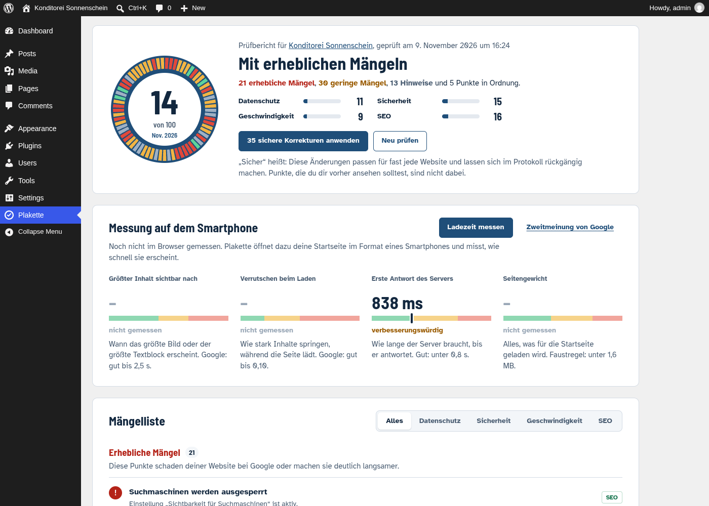

# Plakette – Website-Hauptuntersuchung (WordPress-Plugin)

Von **i-make.media | Magnus Brühl**. Plakette prüft eine WordPress-Website wie bei der Hauptuntersuchung.
Sie hat **78 Prüfpunkte** in vier Bereichen: **Datenschutz**, **Sicherheit** (mit Recht/DSGVO, Cookie-Banner und
Barrierefreiheit nach BFSG), **Geschwindigkeit** und **SEO**. Jeden Mangel erklärt sie in einfachen Worten, und fast
jeden behebt sie auf Knopfdruck. Jede Änderung steht im Protokoll und lässt sich rückgängig machen.

Plakette enthält auch alle Funktionen der Plugins „i-make.media Toolkit for Breakdance“ und „SEO-Helfer für
Breakdance“. Sind die alten Plugins noch aktiv, übernimmt eine Prüfung deren Einstellungen und schaltet sie ab.



Weitere Ansichten: [Cookie-Banner](docs/screenshots/cookie-banner.png) · [Zwei-Klick-Platzhalter](docs/screenshots/zwei-klick.png) · [Impressum-Formular](docs/screenshots/impressum-formular.png) · [erzeugtes Impressum](docs/screenshots/impressum.png) · [Einstellungen](docs/screenshots/einstellungen.png)

## Installieren
1. Unter [Releases](https://github.com/mblmg/plakette/releases) `plakette.zip` herunterladen (oder `exports/plakette.zip`).
2. In WordPress: *Plugins › Installieren › Plugin hochladen* → ZIP wählen → aktivieren.
3. Im Menü links **Plakette** öffnen → **Website jetzt prüfen**.

Per WP-CLI: `wp plugin install https://github.com/mblmg/plakette/releases/latest/download/plakette.zip --activate`

Voraussetzungen: WordPress 6.5 oder neuer, PHP 7.4 bis 8.5.

## Updates
Plakette sieht alle 6 Stunden auf GitHub nach neuen Releases. Sie erscheinen unter *Plugins* und werden automatisch
installiert. Abschalten lässt sich das unter *Plakette › Einstellungen › Plugin*. Bei einem privaten Repository oder
bei Rate-Limits einen Token in die `wp-config.php` schreiben:

```php
define( 'PLAKETTE_GITHUB_TOKEN', 'github_pat_…' ); // Fine-grained Token, nur „Contents: Read“ für mblmg/plakette
```

## Was geprüft und behoben wird
| Bereich | Prüfungen (Auswahl) | Behebung |
|---|---|---|
| **Datenschutz** | fremde Server im Überblick, YouTube/Vimeo/Maps ohne Einwilligung, Google Fonts, CDN-Dateien (unpkg, jsDelivr …), Gravatar, volle IP-Adressen in Kommentaren, Datenschutzhinweis am Kommentarformular | Zwei-Klick-Platzhalter, Schriften und Skripte lokal, lokale Profilbilder, IPs kürzen – ein Klick |
| **Sicherheit** | Updates (WordPress, Plugins, Themes, automatisch), Sicherheitsschlüssel, Login-Sperre, Sicherheits-Header, gemischte Inhalte, Benutzernamen-Ausspähung, XML-RPC, „admin“-Benutzer, Datei-Editor, Fehlerausgaben, öffentliches debug.log, Verzeichnislisten, offene Registrierung, Versionsangaben, ungenutzte Plugins, Backups, HTTPS, PHP-Version | ein Klick; Server-Themen als fertige Nachricht an den Hoster |
| **Recht & DSGVO** (in Sicherheit) | Cookie-Banner nötig?, Impressum (§ 5 DDG), Datenschutzerklärung, fehlende Dienste darin, Rechtliches auf jeder Seite verlinkt, veraltete OS-Plattform-Links (seit 20.07.2025), alte Gesetzesnamen (TMG, RStV, TTDSG), Shop: Bestellknopf, AGB/Widerruf | eigener Cookie-Banner (blockiert Tracking bis zur Einwilligung), Impressum und Datenschutzerklärung aus Firmendaten und erkannten Diensten, Link-Leiste im Footer |
| **Barrierefreiheit** (BFSG, in Sicherheit) | Sprache der Seite, Zoom gesperrt, Formularfelder ohne Beschriftung, Links ohne Text (auch Breakdance „custom“), unsichtbare Einblendanimationen, Barrierefreiheitserklärung für Shops | ein Klick |
| **Geschwindigkeit** | Seiten-Cache, Komprimierung, Browser-Cache, große Bilder, LCP-Bild (auch bei Page-Buildern, mit WebP), Bildmaße, blockierende Skripte, Emoji, jQuery Migrate, Dashicons, Datenbank, Objekt-Cache | ein Klick |
| **SEO** | Sichtbarkeit, Permalinks, Sitemap, robots.txt, Titel, Beschreibungen, Open Graph, strukturierte Daten, Firmenprofil (LocalBusiness), Beitragsbilder, Bild-Sitemap (Yoast/Rank Math), Alternativtexte, H1, kaputte Links, Beispielinhalte | Vorschläge zum Bearbeiten, dann ein Klick |

Außerdem:
- **Firmendaten einmal eintragen:** Daraus entstehen Impressum, Datenschutzerklärung und das Firmenprofil für Google
  (Adresse, Öffnungszeiten, Angebote).
- **Cookie-Banner:** „Alle akzeptieren“ und „Nur notwendige“ sind gleich groß, Einstellungen gibt es je Kategorie.
  Die Einwilligung wird nur im Browser gespeichert, deshalb funktioniert der Banner auch mit Seiten-Cache.
  Kommt ein neuer Dienst hinzu, fragt der Banner erneut. Ist kein Tracking da, sagt Plakette: „Kein Banner nötig.“
- **Messung im Browser** (LCP, CLS, Serverantwort, Seitengewicht) und auf Wunsch eine Zweitmeinung von Google PageSpeed.
- **Vergleichsansicht ohne Umbauten:** an eine beliebige Seiten-URL `?plakette_aus=1` anhängen.
- **Nach jeder Änderung** leert Plakette die Caches von WP-Optimize, WP Super Cache, Autoptimize, WP Rocket, W3TC und LiteSpeed.
- **Breakdance:** Kapitel-Navigation und Autoren-Bio als dynamische Felder, GSAP lokal, Breakdance-Bilder in der Sitemap.

Die Rechtstexte erzeugt Plakette aus dem, was sie auf der Website findet. Sie ersetzen keine Rechtsberatung.
Bitte lies sie nach dem Erstellen einmal durch.

## Getestet
Testseite mit absichtlich eingebauten Mängeln, echtes WordPress (Playground), PHP 7.4 und 8.3 (`tests/e2e.sh`):

| | vorher | nach „alles beheben“ |
|---|---|---|
| Gesamt | 14 | **93** |
| Datenschutz | 11 | 100 |
| Sicherheit | 15 | 89 (offen: HTTPS, Apache-Regeln und Backups – im Testsystem nicht möglich) |
| Geschwindigkeit | 9 | 93 |
| SEO | 16 | 100 |
| Serverantwort | 888 ms | 59 ms |

- Die 59 Behebungen liefen ohne Fehler. Danach wurde alles rückgängig gemacht, und das Prüfergebnis war identisch mit
  dem Ursprungszustand. Ausgenommen ist, was absichtlich endgültig ist: Löschen, Updates, Datenbank aufräumen.
- 0 PHP-Warnungen aus dem Plugin, unter PHP 7.4 und PHP 8.3.
- **Nicht getestet** (gibt es im Testsystem nicht): `.htaccess`-Regeln unter Apache, HTTPS/HSTS, echte Plugin- und
  Core-Updates, WooCommerce, Yoast/Rank Math, ein echtes Breakdance.

## Entwickeln und veröffentlichen
- Aufbau und Konventionen: [`docs/DEVELOPING.md`](docs/DEVELOPING.md)
- `tools/lint.sh`: PHP-Syntax aller Dateien
- `tests/e2e.sh 8.3`: Ende-zu-Ende-Test in echtem WordPress
- `tools/build.sh`: baut `exports/plakette.zip`

**Neue Version:**
1. Abschnitt `## [1.1.0] - Datum` in `CHANGELOG.md` schreiben.
2. `tools/release.sh 1.1.0 --push` ausführen. Das Skript setzt die Versionsnummer an allen Stellen, prüft, baut, committet und taggt.
3. Die GitHub-Action (`.github/workflows/release.yml`) prüft Version und PHP-Syntax (7.4 und 8.3), baut `plakette.zip`
   und legt das Release an. Alle installierten Plakette-Plugins aktualisieren sich danach selbst.

## Lizenz
GPL-2.0-or-later, siehe [LICENSE](LICENSE). Schriften im Admin: Atkinson Hyperlegible und Barlow Semi Condensed (SIL OFL 1.1).
